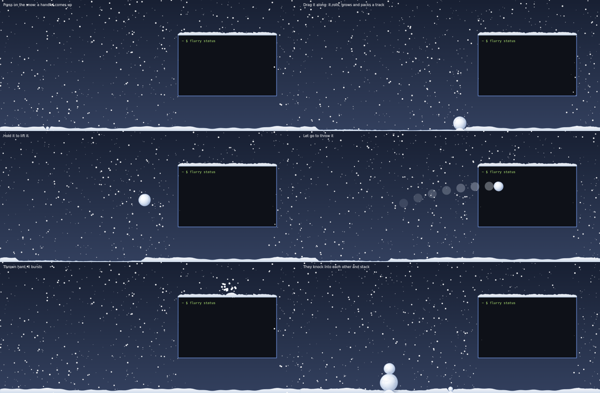
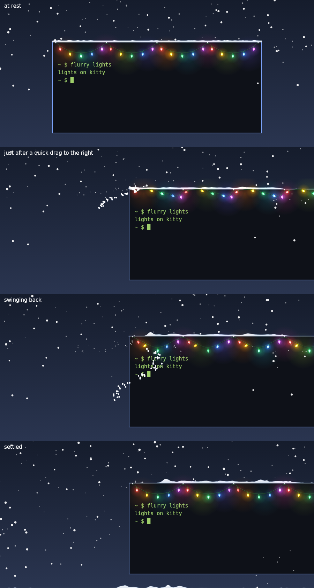

# Flurry

Weather for your [Omarchy](https://omarchy.org) Quattro desktop.

Snow falls over your windows and piles up on their top edges. Fling a window
and the snow flies off it. Grow Christmas trees and hang baubles, lights and
candy canes on them, string lights along your windows, roll snowmen and set
them on your windows, and send them
to friends on a little train. Santa rides by now and then, and a Yeti may come
for your snowman.


## Install

```bash
omarchy plugin add https://github.com/itscallssh/omarchy-flurry.git --enable
```

The snowflake lands on the right of the bar. Requires Omarchy 4 (Quattro) or
later. Gifts between friends also need `curl` and `wl-clipboard`, which
Omarchy ships.

## Use it

| | |
|---|---|
| Click the bar icon | Effects, amount, decorate, friends |
| Right-click it | Weather on or off |
| Scroll on it | Next or previous effect |
| Drag a decoration | Move it; drop a snowman on a window's top edge and it rides that window |
| Right-click a tree or snowman | Send it to a friend, or remove it |
| Click a gift or a letter | Open it |
| Click Santa | He drops a present |
| Click the Yeti | He runs off without your snowman |

### Six kinds of weather

- **Snow** settles on window tops and the ground. Drag a window gently and it rides along; jerk or fling it and the snow slides, tears off the trailing edge and falls; stop hard and it's thrown forward. Close a window and its snow drops.
- **Leaves** pile up and scatter when you brush the pointer through them.
- **Starfall**: shooting stars that burst into sparks on your windows.
- **Rain** splashes where it lands, with lightning now and then.
- **Sakura** petals drift down and rest on your windows for a while.
- **Fireflies** drift about and gather where the pointer rests.

### How the snow behaves

Every falling thing shares one gravity. Flakes, powder and petals reach their
fall speed through drag in moving air: a slow wind, gusts that vary across the
screen, and the wake of a fast pointer. Chunks are heavy and fall fast.

Snow on a window is a height field that carries its own sliding speed. The
window's motion is estimated from its position samples, and in the window's
frame the snow feels gravity minus the window's acceleration:

- **Friction.** It holds until the sideways pull beats static friction, then
  slides, braked by kinetic friction, and sticks again once it stops. Each
  patch grips a little differently, so a slab tears instead of moving as one.
- **Cohesion and age.** Fresh powder is loose: it slides easily, smears, and
  turns to dust. Over a couple of minutes it settles: it grips better, holds
  steeper slopes, moves as slabs, and breaks off in chunks.
- **Edges.** Snow that slides past an edge hangs there as a small cornice and
  breaks off once it's too heavy. Piles steeper than the angle of repose
  slump, and an over-full edge pours over on its own.
- **Lift-off.** Drop a window (or stop it rising) faster than gravity and the
  snow floats off and lands again.
- **Spray and wind.** A fast-moving window strips loose powder into a trailing
  plume; wind drifts loose snow downwind.
- **Landing.** Chunks shed dust as they fall, break up when they hit hard, and
  skid a little along whatever they land on. Rising windows scoop up the snow
  falling onto them.
- **Hidden, not lost.** Snow on a window behind another is hidden where it's
  covered and shows again when the front window moves. A window on another
  workspace keeps its snow until you come back. Resizing keeps the snow where
  it lies and drops what the window no longer reaches.

### The snow plow

When snow along the bottom of the screen gets deep (on average 42% of the
way to full), a yellow bulldozer drives in from the edge with its blade up,
lowers it, and pushes the snow across and off the far side. It's part of
the simulation, not an animation over it:

- The blade scrapes the ground snow down to nothing, and what it scrapes
  becomes a berm heaped against the blade. The berm grows to well over the
  blade's top, and its weight slows the dozer down.
- Chunks tumble off the berm's face, land ahead of it and get pushed again;
  a berm over the blade's top curls powder over it.
- The tracks' bottom run stays put on the ground while the top run moves,
  the wheels and sprocket turn by the distance driven, the nose dips as the
  berm pushes back, and the engine shakes it a little.
- The exhaust puffs harder under load and drifts on the wind; the beacon
  turns; snow settles on the cab roof and slides off when it pulls away.

It leaves once its rear is past the edge, rests at least six seconds, and
comes back from the other side next time the snow builds up. Turn it off in
the menu (**Snow plow**), or call it now with `flurry plow`.

### Snowballs

Press on snow that's lying deep enough (the pointer turns into an open hand
over it) and a lumpy handful comes up. Drag it along the snow and it rolls:

- **It grows.** Each stretch of fresh snow it rolls onto sticks to it as a
  layer, more from settled snow than from powder, so it gets bigger the
  further you roll it, and rounder as it goes. New layers show as clumps and
  seams on its face, and they turn with it.
- **It rolls.** It turns exactly as far as it travels, keeps its momentum,
  slows as it picks up snow (what it collects was standing still) and to
  rolling resistance that grows in deep snow, rolls downhill and off window
  edges, and lags on a window that starts moving, the way a ball on a tray
  does.
- **The snow gives.** It's squeezed to fit under the ball until it's packed
  firm, so the ball sinks into its own print, leaves a smooth, glazed track,
  and kicks loose snow off its front when it moves fast.

Hold a ball to pick it up: it hangs from the pointer on a spring that
softens as it grows, so a big one lags and sags. Let go mid-swing to throw
it. It keeps that speed and spin, falls under gravity, bounces a little
(less in deep snow), and throws up snow where it lands. Throw it hard at a
window, the ground or the side of the screen and it bursts: some of it
sticks there as a splat, the rest flies off in chunks and powder. Balls knock
into each other, and one set gently on top of another stays there, so you
can build a snowman. The plow scoops small balls into its berm and shoves
big ones ahead of it.

Snow only takes the pointer where it's at least 4 px deep, or where there's
a ball. Everywhere else your clicks go to your windows as usual. If the
snow along the bottom gets in the way of clicking, switch **Snowballs** off
in the menu or run `flurry snowballs`.



Leaves and petals fall like paper: they swing, tilt, and sink fastest through
the middle of each swing. Resting ones slide to a stop, come off a window that
lurches harder than they can hold, and lift in strong gusts. Snowmen standing
on a window rock on a damped spring when it is dragged.

### Decorate

Pick **Decorate** in the menu (or `flurry decorate`). A toolbar appears: plant
up to three trees, roll snowmen, then click a tree with the bauble, lights,
candy cane or star tool. **Remove** clears whatever you click. **Done** or
Esc leaves decorate mode. Everything stays where you leave it across
restarts, and a snowman on a window travels with it between workspaces.

The tree is painted in layers: drooping boughs with needle texture and the
shadow each tier casts on the one below, snow lying on the boughs, glass
baubles with a highlight, a window reflection and a gold cap, and a faceted
gold star. Its bulbs breathe rather than blink, each on its own slow rhythm.
They light the needles around them, put small coloured glints in the
baubles beside them, and the star glows with soft rays.

### Lights on your windows

Pick **Window lights** in the toolbar and click a window: a string of
lights hangs along its top edge. Click again for other colours (warm white,
classic colours, icy blue, candy cane); **Remove** takes it down. Or bind
`flurry lights`, which does the same for the focused window and turns it off
after the last colour.

Lights belong to the app, not the window: every terminal gets them if you
decorate one, and they come back when you open it again. The wire is
simulated: clips hold it every 150 px or so and it hangs in loose swags
between them. Drag the window and the swags trail behind and swing back,
each bulb swinging on its socket. Gusts sway it, and so does a fast pointer
brushing past. Resizing re-spaces the clips. The bulbs throw coloured light
on the window under them, and windows in front hide them like anything else.



### Friends and the little train

1. **Set up friends** in the menu, then **Copy my code** and send it to a friend.
2. Copy their code and press **Add from clipboard** (or `flurry add <code>`).
3. Right-click a snowman or tree, **Send to …**. The train comes for it, and it
   pulls up on your friend's desktop. Notes go the same way.

Gifts travel over [ntfy](https://ntfy.sh): your inbox is a topic named after
128 random bits, so only someone with your code can send to it. Anyone who
has your code can, though, so share it with friends only. To use your own
ntfy server, set `"server"` in `~/.local/state/omarchy-flurry/state.json`.
Incoming gifts are size-checked and validated before anything is drawn.

## From the terminal

`bin/flurry` wraps the IPC target, handy for Hyprland binds:

```bash
flurry toggle | on | off | next
flurry effect rain
flurry intensity 1.5
flurry decorate | santa | yeti | plow | clear
flurry lights             # lights on the focused window, next colours, off
flurry snowballs          # let snow take the pointer, or not
flurry code               # your friend code
flurry add flurry1:…      # or with no argument, from the clipboard
flurry note Ali "Merry Christmas!"
flurry status
```

or directly: `omarchy-shell flurry effect sakura`.

## Performance

Everything draws on one canvas per screen in batched paths. On battery the
effect is halved and capped at 30 fps (turn that off in the menu), and it
stops while a fullscreen app is up. Hyprland sends no events during an
interactive window drag, so while the effect is on the window list is
refreshed over Hyprland's socket every 220 ms, and every frame for two seconds
after something moves, so the physics sees a drag as smooth motion. The
pointer is read for every effect but rain and starfall. The simulation costs
about 0.25 ms a frame on a 2560×1440 screen with six windows at full snow
(measured under node). A terminal with 25 window lights adds about 1.5 ms of
drawing a frame (also under node), and six snowballs about 0.1 ms of
simulation and 2 ms of drawing; a tree's lights repaint
at 30 fps on their own layer and the rest of the tree only when it changes.

## Development

```bash
node --test tests/*.test.js        # simulation and state tests
omarchy plugin validate .
```

The simulation (`lib/sim.js`), drawing (`lib/draw.js`) and state
(`lib/store.js`) are plain JavaScript, so they run under node as well as in the
shell. `tests/render-preview.js` paints every effect to PNG with
`@napi-rs/canvas` for checking the art without a desktop, and
`tests/render-physics.js` renders a filmstrip of a snowy window being flung
and stopped (`docs/physics.png`). `tests/render-plow.js` lets the snow pile
up until the plow comes, then renders its pass and a close-up
(`docs/plow.png`). `tests/render-lights.js` renders a decorated tree and a
light string being dragged (`docs/tree.png`, `docs/window-lights.png`).
`tests/render-snowballs.js` scoops, rolls, lifts, throws, bursts and stacks
snowballs (`docs/snowballs.png`).

| File | What it is |
|---|---|
| `Service.qml` | State, persistence, window and pointer feeds, visitors' schedule, friends inbox, IPC |
| `SceneWindow.qml` | One transparent layer per screen: weather, decorations, Santa, the Yeti, the train |
| `Widget.qml` | The bar icon and its menu |
| `Decoration.qml`, `Visitor.qml`, `ContextMenu.qml`, `Toolbar.qml` | Pieces of the scene |

Inspired by KoiArt for macOS and Windows. Flurry is an independent project;
all art is drawn in code.

MIT licensed.
