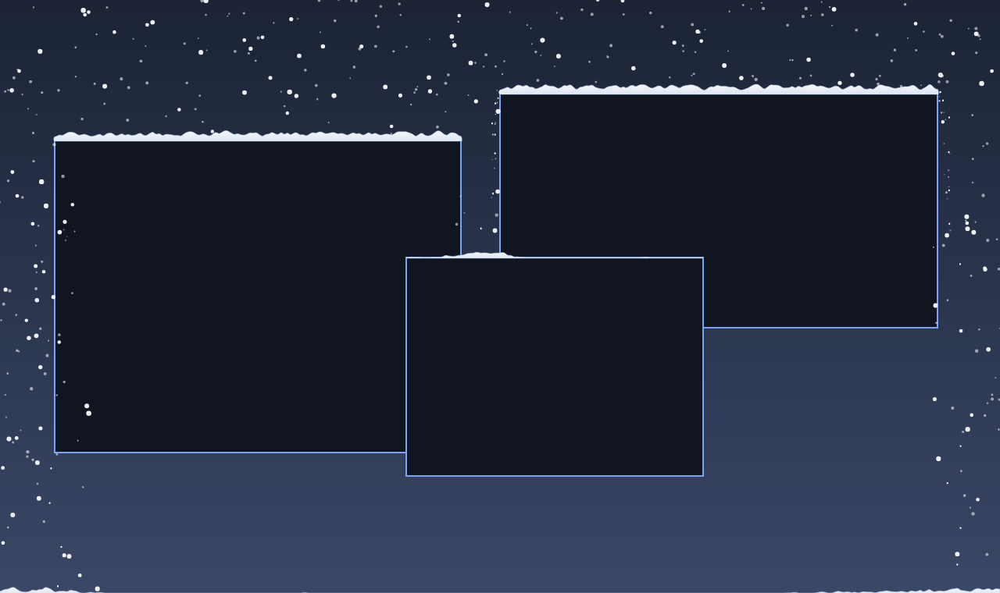

# Flurry

Weather for your [Omarchy](https://omarchy.org) Quattro desktop.

Snow falls over your windows and piles up on their top edges. Fling a window
and the snow flies off it. Grow Christmas trees and hang baubles, lights and
candy canes on them, roll snowmen and set them on your windows, and send them
to friends on a little train. Santa rides by now and then, and a Yeti may come
for your snowman.




## Install

```bash
omarchy plugin add https://github.com/itscallssh/omarchy-flurry.git --enable
```

The snowflake lands on the right of the bar. Requires Omarchy 4 (Quattro) or
later. Gifts between friends also need `curl` and `wl-clipboard`, which
Omarchy ships.

## Use it

| | |
|---|---|
| Click the bar icon | Effects, amount, decorate, friends |
| Right-click it | Weather on or off |
| Scroll on it | Next or previous effect |
| Drag a decoration | Move it; drop a snowman on a window's top edge and it rides that window |
| Right-click a tree or snowman | Send it to a friend, or remove it |
| Click a gift or a letter | Open it |
| Click Santa | He drops a present |
| Click the Yeti | He runs off without your snowman |

### Six kinds of weather

- **Snow** settles on window tops and the ground. Drag a window gently and it rides along; jerk or fling it and the snow slides, tears off the trailing edge and falls; stop hard and it's thrown forward. Close a window and its snow drops.
- **Leaves** pile up and scatter when you brush the pointer through them.
- **Starfall**: shooting stars that burst into sparks on your windows.
- **Rain** splashes where it lands, with lightning now and then.
- **Sakura** petals drift down and rest on your windows for a while.
- **Fireflies** drift about and gather where the pointer rests.

### How the snow behaves

Every falling thing shares one gravity. Flakes, powder and petals reach their
fall speed through drag in moving air: a slow wind, gusts that vary across the
screen, and the wake of a fast pointer. Chunks are heavy and fall fast.

Snow on a window is a height field that carries its own sliding speed. The
window's motion is estimated from its position samples, and in the window's
frame the snow feels gravity minus the window's acceleration:

- **Friction.** It holds until the sideways pull beats static friction, then
  slides, braked by kinetic friction, and sticks again once it stops. Each
  patch grips a little differently, so a slab tears instead of moving as one.
- **Cohesion and age.** Fresh powder is loose: it slides easily, smears, and
  turns to dust. Over a couple of minutes it settles: it grips better, holds
  steeper slopes, moves as slabs, and breaks off in chunks.
- **Edges.** Snow that slides past an edge hangs there as a small cornice and
  breaks off once it's too heavy. Piles steeper than the angle of repose
  slump, and an over-full edge pours over on its own.
- **Lift-off.** Drop a window (or stop it rising) faster than gravity and the
  snow floats off and lands again.
- **Spray and wind.** A fast-moving window strips loose powder into a trailing
  plume; wind drifts loose snow downwind.
- **Landing.** Chunks shed dust as they fall, break up when they hit hard, and
  skid a little along whatever they land on. Rising windows scoop up the snow
  falling onto them.
- **Hidden, not lost.** Snow on a window behind another is hidden where it's
  covered and shows again when the front window moves. A window on another
  workspace keeps its snow until you come back. Resizing keeps the snow where
  it lies and drops what the window no longer reaches.

Leaves and petals fall like paper: they swing, tilt, and sink fastest through
the middle of each swing. Resting ones slide to a stop, come off a window that
lurches harder than they can hold, and lift in strong gusts. Snowmen standing
on a window rock on a damped spring when it is dragged.

### Decorate

Pick **Decorate** in the menu (or `flurry decorate`). A toolbar appears: plant
up to three trees, roll snowmen, then click a tree with the bauble, lights,
candy cane or star tool. **Remove** clears whatever you click. **Done** or
Esc leaves decorate mode. Everything stays where you leave it across
restarts, and a snowman on a window travels with it between workspaces.

### Friends and the little train

1. **Set up friends** in the menu, then **Copy my code** and send it to a friend.
2. Copy their code and press **Add from clipboard** (or `flurry add <code>`).
3. Right-click a snowman or tree, **Send to …**. The train comes for it, and it
   pulls up on your friend's desktop. Notes go the same way.

Gifts travel over [ntfy](https://ntfy.sh): your inbox is a topic named after
128 random bits, so only someone with your code can send to it. Anyone who
has your code can, though, so share it with friends only. To use your own
ntfy server, set `"server"` in `~/.local/state/omarchy-flurry/state.json`.
Incoming gifts are size-checked and validated before anything is drawn.

## From the terminal

`bin/flurry` wraps the IPC target, handy for Hyprland binds:

```bash
flurry toggle | on | off | next
flurry effect rain
flurry intensity 1.5
flurry decorate | santa | yeti | clear
flurry code               # your friend code
flurry add flurry1:…      # or with no argument, from the clipboard
flurry note Ali "Merry Christmas!"
flurry status
```

or directly: `omarchy-shell flurry effect sakura`.

## Performance

Everything draws on one canvas per screen in batched paths. On battery the
effect is halved and capped at 30 fps (turn that off in the menu), and it
stops while a fullscreen app is up. Hyprland sends no events during an
interactive window drag, so while the effect is on the window list is
refreshed over Hyprland's socket every 220 ms, and every frame for two seconds
after something moves, so the physics sees a drag as smooth motion. The
pointer is read for every effect but rain and starfall. The simulation costs
about 0.25 ms a frame on a 2560×1440 screen with six windows at full snow
(measured under node).

## Development

```bash
node --test tests/*.test.js        # simulation and state tests
omarchy plugin validate .
```

The simulation (`lib/sim.js`), drawing (`lib/draw.js`) and state
(`lib/store.js`) are plain JavaScript, so they run under node as well as in the
shell. `tests/render-preview.js` paints every effect to PNG with
`@napi-rs/canvas` for checking the art without a desktop, and
`tests/render-physics.js` renders a filmstrip of a snowy window being flung
and stopped (`docs/physics.png`).

| File | What it is |
|---|---|
| `Service.qml` | State, persistence, window and pointer feeds, visitors' schedule, friends inbox, IPC |
| `SceneWindow.qml` | One transparent layer per screen: weather, decorations, Santa, the Yeti, the train |
| `Widget.qml` | The bar icon and its menu |
| `Decoration.qml`, `Visitor.qml`, `ContextMenu.qml`, `Toolbar.qml` | Pieces of the scene |

Inspired by KoiArt for macOS and Windows. Flurry is an independent project;
all art is drawn in code.

MIT licensed.
